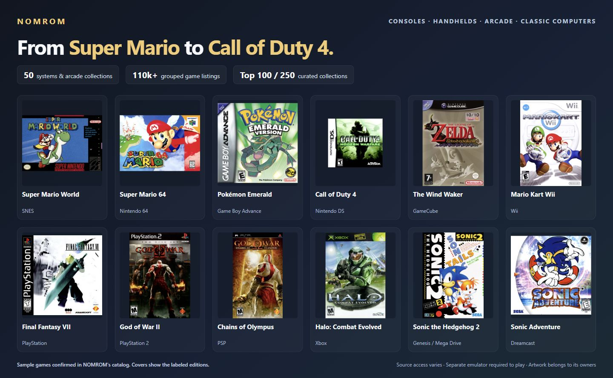
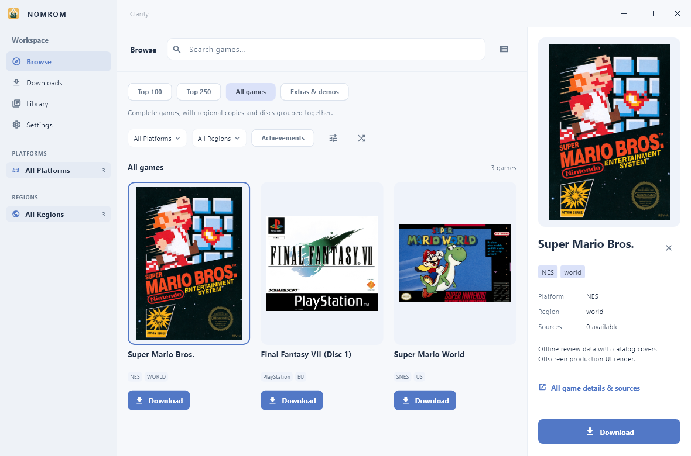
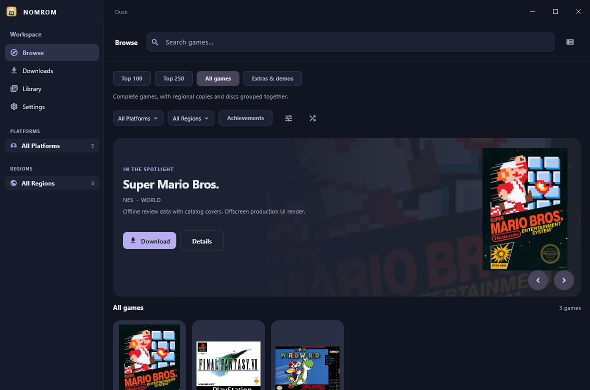
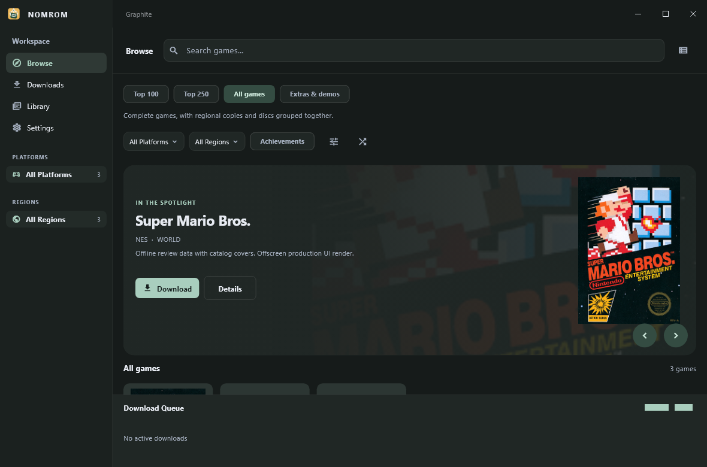
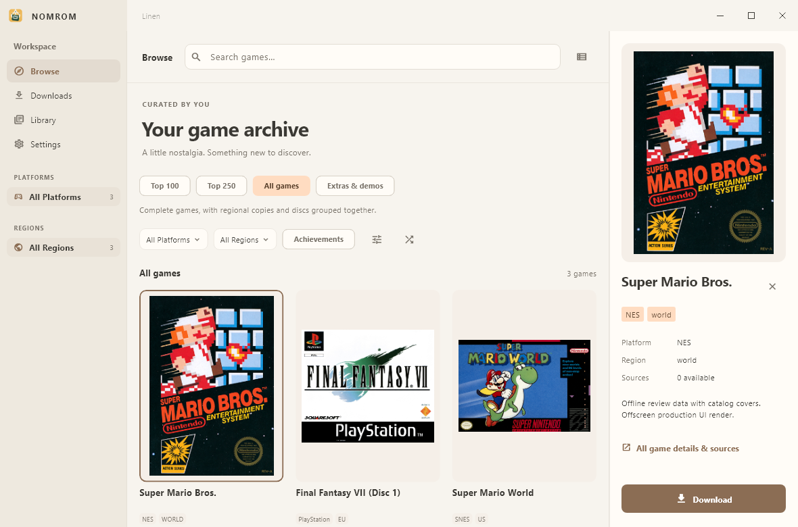
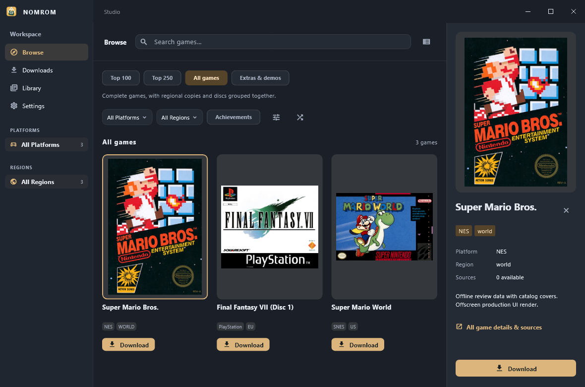

# NOMROM for Windows

**From Super Mario to Call of Duty 4.**

Explore **50 systems and arcade collections** in one Windows app—from NES, SNES and Game Boy to PlayStation 3, PSP, PS Vita, Xbox and Xbox 360. Find the games you remember, discover the ones you missed, and choose the version you want without digging through a wall of regional copies.

**110,000+ grouped game listings · Curated Top 100 & Top 250 · Full game covers · Five themes**

[Download for Windows](https://github.com/MM-482/NOMROM-Releases/releases/latest) · [See the full game list](https://raw.githubusercontent.com/MM-482/NOMROM-Releases/main/NOMROM-Game-Catalog.csv) · [Release notes](https://github.com/MM-482/NOMROM-Releases/releases)

## Games you already know. Systems you grew up with.

Wondering whether NOMROM has Mario, Pokémon, Halo or Call of Duty? These are real examples from the current catalog:

| Looking for… | Examples in NOMROM |
| --- | --- |
| **Super Mario** | Super Mario Bros. — NES; Super Mario World — SNES; Super Mario 64 — Nintendo 64; Super Mario Sunshine — GameCube; Super Mario Galaxy — Wii |
| **Pokémon** | Red — Game Boy; Crystal — Game Boy Color; Emerald — Game Boy Advance; Platinum — Nintendo DS |
| **The Legend of Zelda** | Ocarina of Time — Nintendo 64; The Wind Waker — GameCube; A Link Between Worlds — Nintendo 3DS |
| **Call of Duty 4: Modern Warfare** | **PlayStation 3 and Xbox 360 editions**, plus the separate Nintendo DS edition |
| **Halo & Gears of War** | Halo: Combat Evolved and Halo 2 — Xbox; Halo 3 and Gears of War — Xbox 360 |
| **Final Fantasy** | Final Fantasy VII — PlayStation; Final Fantasy X — PlayStation 2 |
| **Grand Theft Auto** | San Andreas — PlayStation 2 |
| **God of War** | God of War and God of War II — PlayStation 2; Chains of Olympus — PSP |
| **Sonic & Sega favorites** | Sonic the Hedgehog 2 and Streets of Rage 2 — Genesis / Mega Drive; Sonic Adventure, Crazy Taxi and Shenmue — Dreamcast |
| **Persona** | Persona 3 Portable — PSP; Persona 4 Golden — PlayStation Vita |
| **Arcade classics** | Metal Slug, Super Street Fighter II Turbo, Street Fighter Alpha 2 and more across the arcade collections |

These are catalog listings, with source access varying by edition. **Super Mario Bros., World and 64 currently need a configured compatible debrid service on Windows. Call of Duty 4 has direct-source entries for PS3 and Xbox 360; its DS edition needs debrid.**

## All 50 systems and collections

Console generations, handheld libraries, arcade collections and classic computers—all in the same browser.

| Family | Systems and collections in the catalog |
| --- | --- |
| **Nintendo** | NES / Famicom, Famicom Disk System, SNES / Super Famicom, Nintendo 64, Nintendo 64DD, GameCube, Wii, Wii U, Game Boy, Game Boy Color, Game Boy Advance, Nintendo DS, Nintendo DSi, Nintendo 3DS, New Nintendo 3DS, Virtual Boy, Pokémon Mini |
| **PlayStation** | PlayStation (PS1), PlayStation 2, PlayStation 3, PSP, PlayStation Vita |
| **Xbox** | Xbox, Xbox 360 |
| **Sega** | Master System / Mark III, Genesis / Mega Drive, Sega CD / Mega-CD, 32X, Game Gear, Saturn, Dreamcast |
| **Arcade** | Arcade — MAME, Arcade — FinalBurn Neo |
| **Atari** | Atari 2600, Atari 5200, Atari 7800, Atari Lynx, Atari Jaguar, Atari Jaguar CD |
| **NEC** | PC Engine / TurboGrafx-16, PC Engine CD / TurboGrafx-CD, PC-FX, PC-98 |
| **More classics** | Neo Geo CD, 3DO, ColecoVision, Intellivision, CD-i, FM Towns, Pippin |

Want to check a specific game before installing? **[Download the complete game list](https://raw.githubusercontent.com/MM-482/NOMROM-Releases/main/NOMROM-Game-Catalog.csv)** and search its title or filter by system. It contains **110,170 grouped game listings** with version counts. **[Download the 50-system directory](https://raw.githubusercontent.com/MM-482/NOMROM-Releases/main/NOMROM-Catalog-Systems.csv)** for counts, source types and example games.

<strong>See every system, its game count, examples and Windows download sources</strong>

### Nintendo

| System / collection | Grouped game listings | Games you may recognize | Windows sources |
| --- | ---: | --- | --- |
| NES / Famicom | 5,167 | Super Mario Bros.; Super Mario Bros. 3 | **Debrid required** |
| Famicom Disk System | 368 | Zelda no Densetsu: The Hyrule Fantasy; Metroid | **Debrid required** |
| SNES / Super Famicom | 2,650 | Super Mario World; Chrono Trigger | **Debrid required** |
| Nintendo 64 | 596 | Super Mario 64; The Legend of Zelda: Ocarina of Time | **Debrid required** |
| Nintendo 64DD | 20 | F-Zero X: Expansion Kit; Mario Artist: Paint Studio | **Debrid required** |
| GameCube | 1,219 | Metroid Prime; Super Mario Sunshine | Direct sources available* |
| Wii | 3,999 | Super Mario Galaxy; Wii Sports | Direct sources available* |
| Wii U | 2,543 | Super Mario 3D World; Mario Kart 8 | **Debrid required** |
| Game Boy | 1,657 | Tetris; Pokémon: Red Version | **Debrid required** |
| Game Boy Color | 1,750 | Pokémon Crystal Version; The Legend of Zelda: Oracle of Seasons | **Debrid required** |
| Game Boy Advance | 2,503 | Pokémon Emerald Version; Metroid Fusion | **Debrid required** |
| Nintendo DS | 5,539 | New Super Mario Bros.; Mario Kart DS | **Debrid required** |
| Nintendo DSi | 1,850 | Dr. Mario Express; Shantae: Risky's Revenge | Direct sources available* |
| Nintendo 3DS | 5,885 | Super Mario 3D Land; Mario Kart 7 | Direct sources available* |
| New Nintendo 3DS | 100 | Xenoblade Chronicles 3D; Fire Emblem Warriors | **Debrid required** |
| Virtual Boy | 45 | Virtual Boy Wario Land; Mario's Tennis | **Debrid required** |
| Pokémon Mini | 24 | Pokémon Party Mini; Pokémon Pinball Mini | **Debrid required** |

### PlayStation

| System / collection | Grouped game listings | Games you may recognize | Windows sources |
| --- | ---: | --- | --- |
| PlayStation (PS1) | 7,053 | Final Fantasy VII; Metal Gear Solid | Direct sources available* |
| PlayStation 2 | 7,685 | Grand Theft Auto: San Andreas; Final Fantasy X | Direct sources available* |
| PlayStation 3 | 9,923 | Call of Duty 4: Modern Warfare; The Last of Us | Direct sources available* |
| PSP | 3,693 | God of War: Chains of Olympus; Persona 3 Portable | Direct sources available* |
| PlayStation Vita | 3,754 | Persona 4 Golden; Gravity Rush | Direct sources available* |

### Xbox

| System / collection | Grouped game listings | Games you may recognize | Windows sources |
| --- | ---: | --- | --- |
| Xbox | 1,472 | Halo: Combat Evolved; Halo 2 | Direct sources available* |
| Xbox 360 | 5,600 | Halo 3; Call of Duty 4: Modern Warfare | Direct sources available* |

### Sega

| System / collection | Grouped game listings | Games you may recognize | Windows sources |
| --- | ---: | --- | --- |
| Master System / Mark III | 688 | Alex Kidd in Miracle World; Sonic The Hedgehog | Direct sources available* |
| Genesis / Mega Drive | 1,963 | Sonic the Hedgehog 2; Streets of Rage 2 | Direct sources available* |
| Sega CD / Mega-CD | 350 | Sonic CD; Snatcher | Direct sources available* |
| 32X | 54 | Knuckles' Chaotix; Doom | Direct sources available* |
| Game Gear | 464 | Sonic The Hedgehog: Triple Trouble; The GG Shinobi | Direct sources available* |
| Saturn | 1,801 | NiGHTS into Dreams...; Panzer Dragoon | Direct sources available* |
| Dreamcast | 1,062 | Sonic Adventure; Crazy Taxi | Direct sources available* |

### Arcade

| System / collection | Grouped game listings | Games you may recognize | Windows sources |
| --- | ---: | --- | --- |
| Arcade — MAME | 14,447 | Metal Slug; Street Fighter Alpha 2 | Direct sources available* |
| Arcade — FinalBurn Neo | 8,104 | Super Street Fighter II Turbo; Metal Slug | Direct sources available* |

### Atari

| System / collection | Grouped game listings | Games you may recognize | Windows sources |
| --- | ---: | --- | --- |
| Atari 2600 | 598 | Pitfall!: Pitfall Harry's Jungle Adventure; Space Invaders | Direct sources available* |
| Atari 5200 | 82 | Pac-Man; Missile Command | Direct sources available* |
| Atari 7800 | 160 | Ballblazer; Ninja Golf | Direct sources available* |
| Atari Lynx | 260 | California Games; Chip's Challenge | Direct sources available* |
| Atari Jaguar | 203 | Alien vs Predator; Tempest 2000 | Direct sources available* |
| Atari Jaguar CD | 26 | Myst; Blue Lightning | Direct sources available* |

### NEC

| System / collection | Grouped game listings | Games you may recognize | Windows sources |
| --- | ---: | --- | --- |
| PC Engine / TurboGrafx-16 | 448 | Bonk's Adventure; R-Type | Direct sources available* |
| PC Engine CD / TurboGrafx-CD | 497 | Akumajou Dracula X: Chi no Rondo; Ys Book I & II | Direct sources available* |
| PC-FX | 71 | Battle Heat; Choujin Heiki Zeroigar | Direct sources available* |
| PC-98 | 126 | Policenauts; Brandish | Direct sources available* |

### More classics

| System / collection | Grouped game listings | Games you may recognize | Windows sources |
| --- | ---: | --- | --- |
| Neo Geo CD | 108 | Metal Slug; Shin Samurai Spirits: Haoumaru Jigokuhen ~ Samurai Shodown II | Direct sources available* |
| 3DO | 440 | Road Rash; Gex | Direct sources available* |
| ColecoVision | 150 | Donkey Kong; Zaxxon | **Debrid required** |
| Intellivision | 171 | Astrosmash; BurgerTime | **Debrid required** |
| CD-i | 1,879 | Hotel Mario; Zelda: The Wand of Gamelon | Direct sources available* |
| FM Towns | 896 | Ultima VI: The False Prophet; Zak McKracken and the Alien Mindbenders | Direct sources available* |
| Pippin | 27 | Tamagotchi CD-ROM; Ultraman Quiz King | Direct sources available* |

## How downloads work on Windows

**35 system catalogs include direct download sources.** The other **15 currently list torrent game sources**, which need a compatible configured **TorBox or Real-Debrid** service in this Windows edition. A debrid service resolves a supported source into a direct download; source support and availability still apply. Native peer-to-peer torrent downloading is not included in this build.

The system directory marks those debrid-dependent catalogs. A system marked “Direct sources available” can still contain individual editions that need debrid or an account. Pick your game, region and available source in NOMROM.

NOMROM downloads and organizes game files. **Use a separate compatible emulator to play them.** A catalog entry does not guarantee that a particular game will run on your PC, or that its original online services still work.

Catalog snapshot verified November 2, 2026: **110,170 grouped game listings**, covering **144,973 game versions**, across **50 system and arcade catalogs**. The same title on different systems counts separately. The wider **240,755-entry catalog** also includes regional records, revisions and extras; that figure is not a count of unique games. Host availability can change.

## A better way to browse

- **Start with the classics.** Top 100 and Top 250 are curated collections across supported systems. All games and Extras & demos keep the rest of the catalog accessible.
- **Find the right version.** Regional copies, revisions and disc variants are grouped together, with the available versions shown before you download. Multi-disc games keep their individual discs visible.
- **See the game cover.** Cover panels show complete box art, including portrait, square and wide packaging. Banners and screenshots have their own places instead of filling in as covers.
- **Keep your queue organized.** Track downloads, pause and resume supported transfers, choose download folders, and extract supported archives.
- **Open files your way.** Launch a game with its associated app, choose **Open with…** to pick another app, or reveal the file in Explorer.
- **Choose your look.** Five themes—Clarity, Dusk, Graphite, Linen and Studio—with an integrated window caption and controls.
- **Update from Settings.** Check for a new Windows release, read what changed, download it, and start setup from NOMROM.

The Top collections are NOMROM's editorial picks. They are not live sales or download rankings.

## Install NOMROM

1. Open the [latest release](https://github.com/MM-482/NOMROM-Releases/releases/latest).
2. Download **NOMROM-1.10.2-windows-x64-setup.exe**.
3. Run setup, then open NOMROM from the Start menu.
4. Let the catalog load, pick a system or collection, and choose a game to view its available versions.

The installer is the recommended option for updates from inside the app. A separate compatible emulator is needed to play your game files.

| Download | Choose this when |
| --- | --- |
| **setup.exe** | You want a normal Windows installation, a Start menu shortcut, and the ability to start future update installations from NOMROM. |
| **portable.zip** | You prefer an extracted app folder. Keep NOMROM.exe, its DLLs and the data folder together. |
| **windows-source.zip** | You want to inspect the Windows source and build it yourself. |
| **SHA256.txt** | You want the published file checksums. |

The current installer does not have a Windows publisher certificate, so Windows may show an unknown-publisher prompt. Download it from this repository's release page.

## Updating

Open **Settings → App updates → Check for updates**.

For an installed copy, download the update and choose **Install and restart**. NOMROM saves and pauses downloads, closes, and opens the setup wizard. Finish setup to reopen the app. Your settings, library records and downloaded game files stay in their existing locations. Resume paused downloads after reopening.

If an archive is being extracted, let it finish before installing an update. You can continue using NOMROM while an update downloads.

For a portable copy, the app downloads and verifies the new ZIP, then opens its download folder. Close NOMROM and replace the whole extracted app folder.

NOMROM verifies the publisher's signed update information and checks the package's size and SHA-256 hash before installation. The first installation is a manual download. If you are coming from a version without the Windows updater, install this release manually once.

## Covers and game information

**Box covers and game details load without a metadata account.** NOMROM uses
the catalog cover first, then matching [Libretro box art](https://github.com/libretro-thumbnails/libretro-thumbnails).
Wikipedia and Wikidata provide descriptions and game facts where available.

The complete cover stays visible, including portrait, square and wide packaging.
Screenshots, title screens and hero banners remain separate. Downloaded images
are cached locally, and browsing prioritizes visible and selected games.
Existing metadata records can look for a missing cover without losing saved facts.

SteamGridDB is an optional artwork source that uses a personal API key. Some
of its covers are custom designs. Cover availability varies by title, system
and region; a game without matching box art shows a placeholder.

**ScreenScraper is on hold.** NOMROM's application authorization is pending.
It is not needed for Libretro covers or Wikipedia/Wikidata game information.
[The access request is recorded here](https://www.screenscraper.fr/forumsujet.php?frub=12&fsuj=26751).

## Five themes

| Theme | Feel |
| --- | --- |
| **Clarity** | Clean white and blue, with a catalog and selected-game details. |
| **Dusk** | Deep navy and muted lavender, with a spacious cover gallery. |
| **Graphite** | Charcoal and soft mint, with a gallery and download queue. |
| **Linen** | Warm ivory and earthy accents, with catalog details. |
| **Studio** | Slate and amber, with a compact file workspace. |

These previews render the current app interface with controlled review data and real catalog covers. They are not captures of the installed app.

## Requirements and availability

- Windows 10 version 1809 or newer, or Windows 11, on an x64 PC.
- Internet access for catalog refreshes, artwork, online services and downloads.
- Your own compatible emulator to open game files.
- Enough free space in your selected download and extraction folders.

This repository distributes the Windows edition. ARM64 builds have not been qualified. Direct native torrent execution is unavailable in this edition; supported debrid services can resolve compatible sources. Source availability and download access depend on the external service.

NOMROM does not bundle games, BIOS files or an emulator. Use it with content you are authorized to access.

## Found a problem?

[Open an issue](https://github.com/MM-482/NOMROM-Releases/issues) with your NOMROM version, Windows version, the screen or action involved, and the error message. For artwork issues, include the game title, system and region. Please leave passwords, API keys and account details out of screenshots and reports.

## Credits and source

**Made by Mark Mateo.**

NOMROM's Windows edition builds on NOMROM for Mac and the original [Romgi by Christian Prado](https://github.com/caprado/romgi). Original MIT attribution is preserved in the source and release files. The Windows source archive is included with each release.

Game names and artwork belong to their respective owners. Metadata and artwork services are credited to their providers; their availability does not imply endorsement.

Catalog showcase covers come from [Libretro Thumbnails](https://thumbnails.libretro.com/) and [GameTDB](https://www.gametdb.com/).
