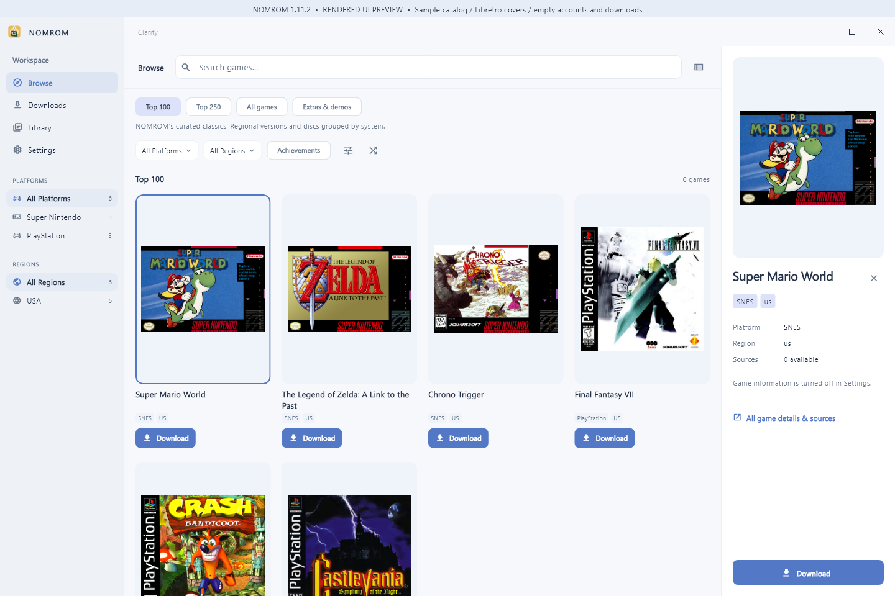
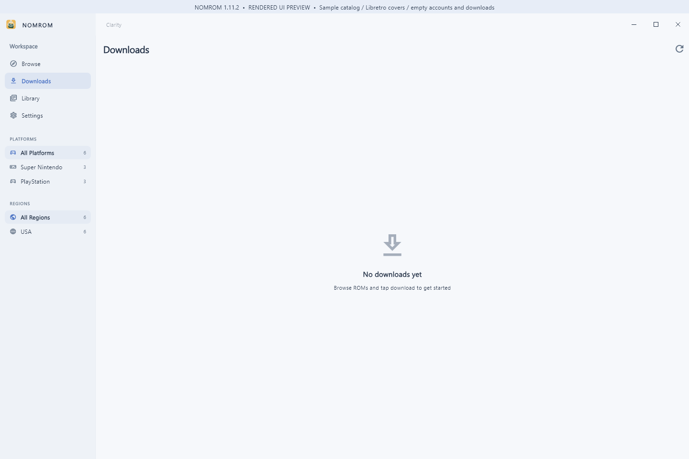
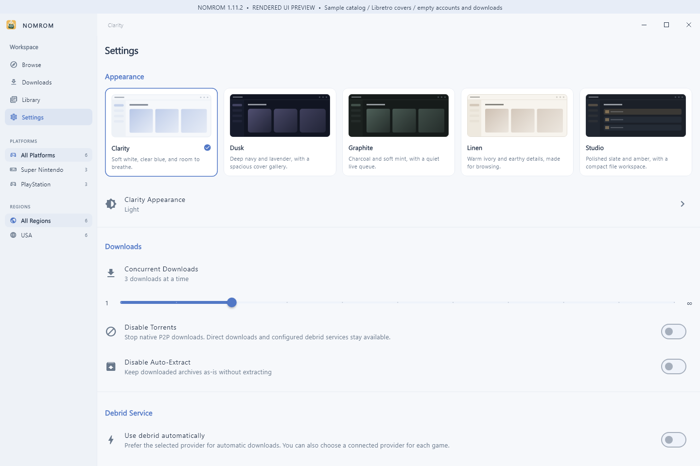

# NOMROM 1.11.2 for Windows — review candidate

**Version 1.11.2 · Build 31 · Prepared November 9, 2026**

This candidate repairs Internet Archive sign-in and download handling and includes the download and local metadata additions made since the public 1.10.2 release. The supplied installer and source archive, a portable ZIP recreated from the complete supplied payload, final checksums and a matching signed update feed have been prepared locally for approval. This is not a published release announcement.

## Internet Archive repair

- Windows sign-in defaults to **Email and Password**. Passwords are masked, significant leading/trailing spaces are preserved, Enter submits once, and duplicate submissions are blocked while a request runs. API keys remain an explicit separate mode.
- Password login uses Internet Archive's JSON authentication protocol. Both download cookies and both returned S3 keys must be present before a session is saved. Cookie attributes are excluded from the outbound Cookie header.
- A failed save retains the previous durable session. Safe errors omit passwords and raw authentication responses.
- Public Archive URLs are no longer forced through a login requirement solely because of their host.
- Archive service failures remain service errors. Rejected sessions and authenticated item-permission failures retain separate handling.
- Redirects and metadata-mirror destinations apply the same credential restrictions: only verified HTTPS Archive destinations receive credentials.

API keys alone do not establish the cookie session needed for protected downloads. To review the account flow, open **Settings → Internet Archive**, use Email and Password, connect with your own account, then try a protected item that the account is permitted to access. Restart and check that the session remains connected. Successful login does not grant permission for every item.

## Included changes since 1.10.2

- **Named debrid choices and retries.** TorBox and Real-Debrid remain explicit choices, and the saved provider stays attached through retries. Preparation/failure results retain useful reasons. Waiting tasks expose **Check again** and source selection.
- **More careful TorBox file matching.** The source retains catalog-aware matching and selective ZIP retrieval, with checks against the chosen game rather than treating an unrelated returned archive as the requested file.
- **Windows native torrent engine.** A built-in in-process transport can discover metadata and peers, select the requested file, verify piece hashes and report progress through the normal queue. Startup and file-selection handling are included. Live public-peer behavior remains unverified in this review.
- **Skraper gamelist imports.** Preview local `gamelist.xml` data and images, assign the correct system and artwork roles, and import them without executing Skraper or requiring a metadata account. Covers remain separate from screenshots and composite artwork.
- **Local ROM identification.** Compute CRC32, MD5 and SHA-1 for a chosen file locally. A separate explicit action can send identifiers to ScreenScraper when the publisher-enabled build and personal account are available.
- **Optional ScreenScraper configuration.** The source records publisher application access accepted on November 7. Personal login and known-game metadata/front-cover results have not been verified. The candidate retains account-free Libretro covers, Wikipedia/Wikidata facts and local imports.
- **Windows build launcher repair.** Source-rewriting steps that could corrupt provider labels were removed, and provider identity now controls the labels and selection checks.

The existing Browse, Downloads, Library and Settings flows, curated Top 100/250, grouped regional and disc versions, complete cover aspect ratios, five themes, Windows file actions and signed-update verification remain part of the app.

## App previews

These previews render the 1.11.2 production Windows widgets with a sample catalog and empty accounts/downloads. They are labeled rendered UI previews and are not screenshots of a live signed-in session or evidence of completed account/transfer tests.

## Candidate files

| File | Purpose |
| --- | --- |
| `NOMROM-1.11.2-windows-x64-setup.exe` | Standard Windows x64 installer. |
| `NOMROM-1.11.2-windows-x64-portable.zip` | Recreated from the complete supplied Portable folder; 17,037,659 bytes. All 33 payload manifest entries and ZIP file contents were verified. Extract everything together. |
| `NOMROM-1.11.2-Source.zip` | Supplied source archive with the original MIT license and build documentation. |
| `NOMROM-1.11.2-windows-x64-SHA256.txt` | Fresh checksums for the actual staged Windows packages. The original attachment did not include its referenced portable ZIP, so its original ZIP hash does not apply to the recreated ZIP. |
| Source checksum and `CONTENTS-SHA256.txt` | The supplied source archive has a separate prepared checksum; the supplied contents manifest was checked against the attachment. |
| `windows-stable.json` | Prepared locally with the existing publisher key matching the binary’s compiled public-key fingerprint. Public-key signature verification and tamper rejection passed. It has not been uploaded or published. |

Until this candidate is approved and published, the working public download is [NOMROM 1.10.2](https://github.com/MM-482/NOMROM-Releases/releases/tag/v1.10.2).

Requires Windows 10 version 1809 or newer, or Windows 11, on an x64 PC. NOMROM does not bundle games, BIOS files or an emulator. Use a separate compatible emulator with content you are authorized to access. An unsigned Windows installer can show an unknown-publisher prompt; the signed update manifest is a separate mechanism.

## Validation and remaining work

The supplied November 9 validation report states:

- Whole-project Dart analysis with fatal infos found no issues.
- **122 focused tests passed**, with zero failures or skips, using the existing test bodies and an in-process runner after the standard runner could not connect its local socket. Coverage included authentication, login widgets, download buttons, host adapters and mocked HTTP transport.
- A Windows x64 release was compiled with MSVC 19.51; executable version fields report **1.11.2+31**. Runtime payload/architecture checks and an early configuration probe passed.

These are the supplied build report's results, not a new execution of the full test suite. The report explicitly leaves live account sign-in, protected Archive downloads, real loopback HTTP tests, the complete application suite and a full interactive smoke test unverified.

The current review independently verified the supplied hashes and all 33 portable payload manifest entries, recreated and checked the complete portable ZIP, and prepared fresh checksums. A local update feed was signed with the existing publisher key matching the binary’s compiled public-key fingerprint; public-key verification accepted it and rejected tampering. No assets or feed have been uploaded or published. The live in-app updater flow and a previous-version in-place upgrade remain untested.

The supplied broader audit lists three follow-ups that are **not fixed by this authentication repair**:

1. Native torrent finalization can remove an existing destination before its replacement copy succeeds, risking loss of the old file if that copy fails.
2. Finalization needs pause/cancel checks after awaited operations to prevent late completion from overriding a paused or cancelled task.
3. An unrelated nonempty file/folder with the same stem can be mistaken for an already-extracted archive.

The candidate must not be described as fully audited, as having verified every download source, or as guaranteeing emulator compatibility. Catalog counts and exported CSVs refer to the November 2 snapshot; source reachability can change.

## Credits

**Made by Mark Mateo.** Based on NOMROM for Mac and the original [Romgi by Christian Prado](https://github.com/caprado/romgi), with the original MIT attribution preserved. Artwork and metadata remain credited to their providers and contributors.
