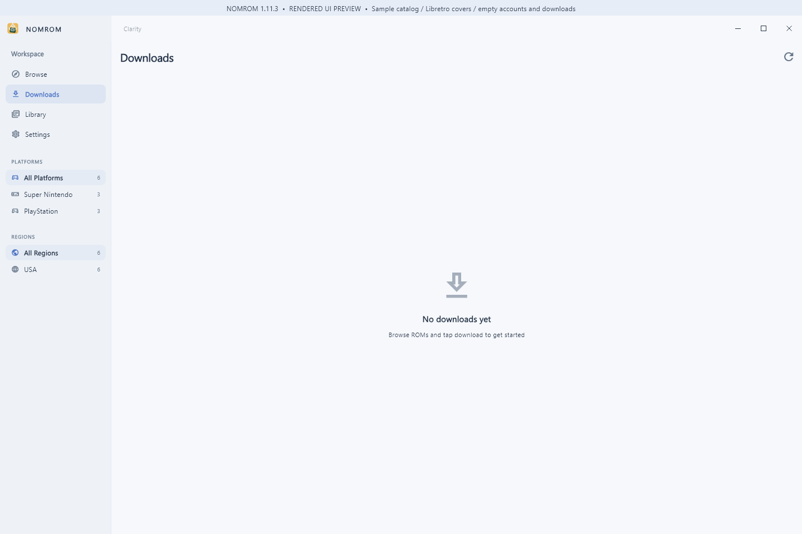
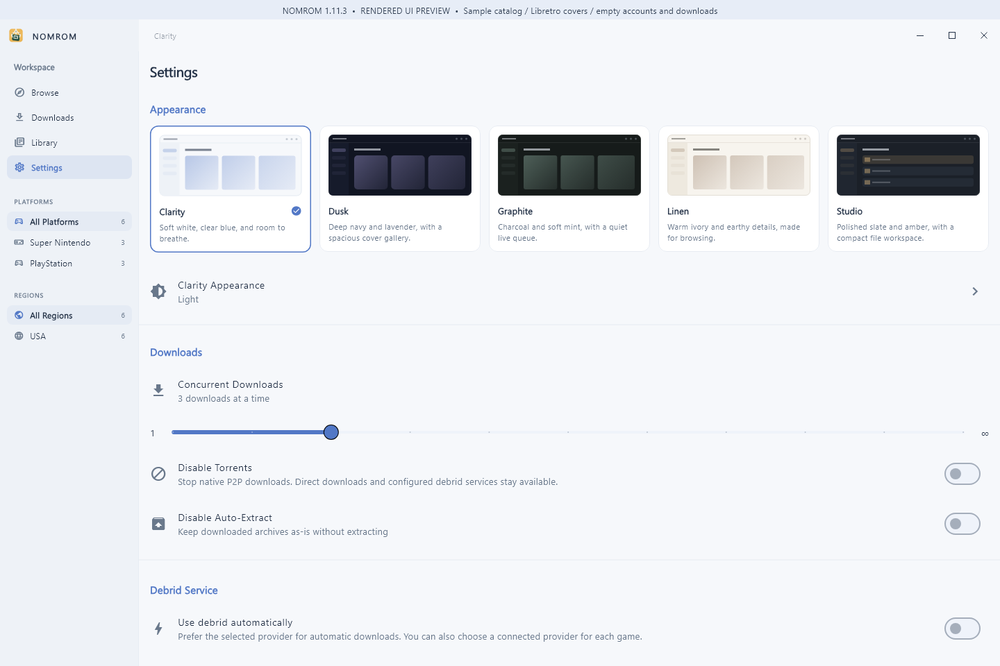

# NOMROM 1.11.3 for Windows — download-safety review candidate

**Version 1.11.3 · Build 32 · Prepared November 9, 2026**

This candidate replaces the 1.11.2 review package and addresses all three download findings from that review. It retains the Internet Archive sign-in repair and the download, artwork and local metadata changes made since public 1.10.2. Publication remains pending the publisher's review.

## Three download fixes

| Previous behavior | New behavior |
| --- | --- |
| Torrent finalization deleted an existing destination before copying the replacement. A failed copy could lose the old file. | Copy into a unique staging directory beside the destination, check the copied length, then publish through a short same-volume rename. Keep the previous destination as a backup until publication succeeds; restore it if publication fails. A failed or incomplete copy leaves the original destination and torrent source intact. |
| A late completion could continue after pause, cancel or disposal during an awaited folder lookup, copy, extraction or database write. | Track each torrent run separately, invalidate it as soon as user intent changes, and recheck after asynchronous work and before publication. Pause/cancel owns the final state. Stale callbacks cannot complete a later run of the same task. Extraction publication also uses a short rename without an asynchronous gap after its activity check. |
| Any nonempty file or folder with the same stem could make an archive appear already extracted. | Reuse requires an app-created extraction receipt for the exact catalog/system/archive/source identity. The recorded output files, sizes and modification times must still match. Unrelated documents, folders, changed or missing output, path escapes and symlinks cannot establish extraction completion. |

Receipts are written only after successful extraction while the task remains active. They exclude credential-bearing source URLs. A receipt-storage error disables later reuse without discarding a safely extracted result. Existing files without a receipt are preserved; they are no longer accepted as proof of a previous extraction. If a fresh extraction would collide with existing content, NOMROM reports the collision instead of overwriting it.

Regression tests cover failed partial copies, wrong copy lengths, successful replacement, pause/cancel/dispose during destination lookup, pause/cancel during copying and delayed failure shutdown, in-flight completion writes, pause/resume, extraction interruption, and app-update interaction. Receipt tests and actual-service HTTP/native-torrent tests cover both safe reuse and false same-name matches. See the [validation record](../review/v1.11.3-validation.md) for fresh results and boundaries, and the [source patch](../source-changes/v1.11.3-download-safety.patch) for the changes against the supplied 1.11.2 source.

## Included from the previous candidate

- Internet Archive email/password login uses the JSON authentication protocol, validates the complete returned session, preserves a previous durable session if a replacement cannot be saved, and keeps API-key mode separate.
- Public Archive links are not treated as login-required solely because of their host. Service errors, rejected sessions and item-permission failures remain distinct. Credentials are restricted to verified HTTPS Archive destinations, including redirects and metadata mirrors.
- TorBox and Real-Debrid remain explicit download choices, preserve the selected provider through retries, and retain useful failure reasons and source-recovery actions.
- The source includes native Windows selective torrent transport, Skraper `gamelist.xml` imports, local ROM identification and optional ScreenScraper configuration.
- Browse, Downloads, Library and Settings retain the 50-system catalog presentation, curated Top 100/250, grouped variants, complete cover aspect ratios, five themes, Windows file actions and signed-update verification.

## App previews

These render the production Windows widgets with sample catalog entries, real Libretro covers and empty accounts/downloads. They illustrate the interface; they do not establish a live sign-in or completed transfer.

## Download and release status

The proposed release files are an x64 installer, a portable ZIP, the updated source ZIP, SHA256 checksums and a matching signed `windows-stable.json`. The [asset inventory](../review/v1.11.3-assets.json) identifies the files prepared locally for review. No 1.11.3 download URL is advertised as live. The public download remains [1.10.2](https://github.com/MM-482/NOMROM-Releases/releases/tag/v1.10.2) until approval and publication.

Requires Windows 10 version 1809 or newer, or Windows 11, on x64. The app and installer do not carry an Authenticode publisher certificate. Signed updater verification is a separate mechanism. NOMROM does not bundle games, BIOS files or an emulator.

## Validation boundaries

The fresh automated results and native build/package checks are recorded in the [validation record](../review/v1.11.3-validation.md). The tests use scratch files and controlled service responses to exercise the real download service. They do not use the user's library or accounts.

Live Internet Archive personal login and protected-item downloads, external debrid/torrent transfers, personal ScreenScraper known-game lookup and a previous-version in-place upgrade are separate checks. No successful result for those flows is inferred from these regression tests. Catalog counts and CSV exports remain the dated November 2 snapshot; source reachability and emulator compatibility vary.

## Credits

**Made by Mark Mateo.** Based on NOMROM for Mac and the original [Romgi by Christian Prado](https://github.com/caprado/romgi), with original MIT attribution preserved. Artwork and metadata retain their provider and contributor credits.
