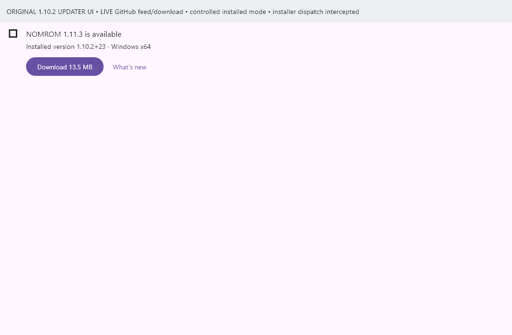
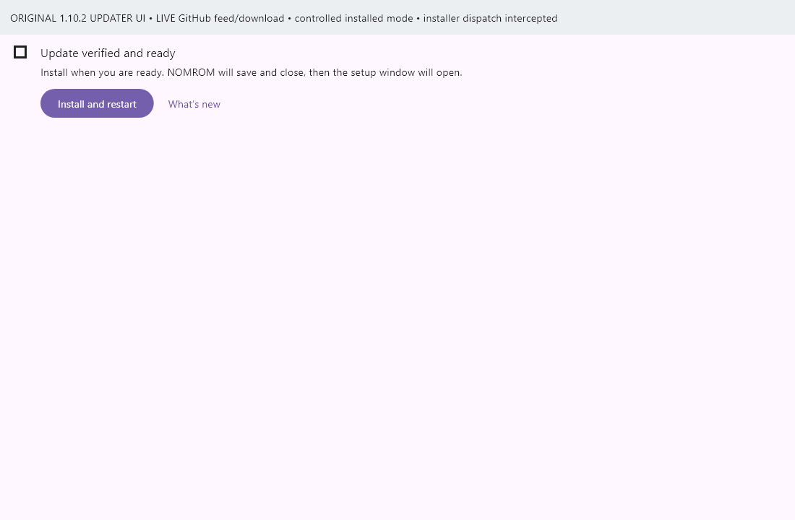
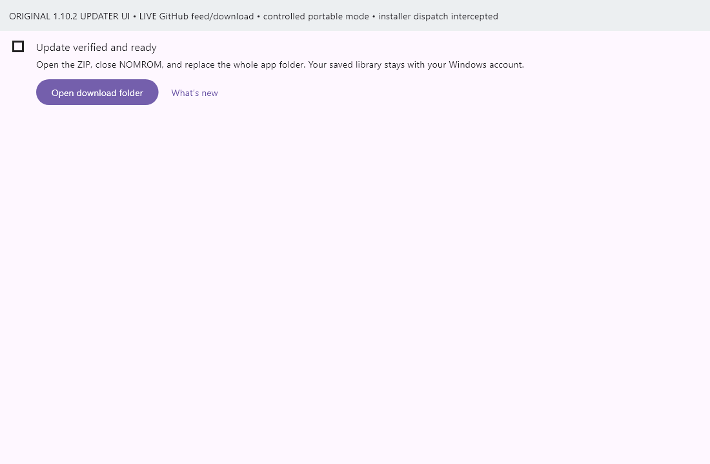

# Verified direct update: NOMROM 1.10.2 to 1.11.3

The published **1.10.2+23** updater supports a direct update to **1.11.3+32**. No intermediate 1.11.0 installation is required.

Three live compatibility tests passed on the official Flutter runner with **zero failures and zero skips**. They exercised the exact original 1.10.2 production update tile, notifier and service in an isolated widget harness, controlled installed/portable environments, the actual published latest-release feed and actual GitHub installer/ZIP downloads. Cryptographic and package checks used the native Windows CNG implementation compiled directly from the original published 1.10.2 source.

| Mode | Verified behavior |
| --- | --- |
| Installed | Check for updates detected 1.11.3+32. Download fetched and verified the 14,111,110-byte setup EXE. The original UI displayed Install and restart and its confirmation dialog. The original notifier/service install-dispatch boundary passed with final launch intercepted. |
| Portable | Check for updates detected 1.11.3+32. Download fetched and verified the 17,050,994-byte ZIP. The original UI displayed Open download folder and passed its reveal dispatch. Manual replacement of the whole extracted app folder remains the portable update method. |

The original published portable/source ZIP hashes matched GitHub's asset digests. The old compiled feed address, key ID and public-key fingerprint match the new release. Original numeric version comparison accepts the direct version jump. The updater service, notifier, tile and native verification source are byte-identical between 1.10.2 and 1.11.3.

The original native verifier accepted the final published feed and both real packages. Changed payload/signature/key, incorrect size/hash and attempts to write to a verified locked package were rejected. The live feed SHA256 is `d191d8bb58f4d5ded4da58f42929c420d7b5082e429d1a240a4ce973ed8a2b3e`.

A separate runtime check of an existing 1.11.1+30 app also detected the public 1.11.3 update, downloaded the installer and reached Update verified and ready. Its final Install and restart action was left unpressed.

## Verification captures

These are clearly labeled isolated captures of the **original 1.10.2 production updater widgets**, using real published feed/downloads and controlled environments. They are not screenshots of a full old-app installation or an executed setup wizard.

## Boundaries

No actual installer or in-place installation was executed. The original full 1.10.2 app was not opened against the user's saved accounts or databases. Production code, installed app files, saved settings and games were not changed by these checks. A brief initial latest-release redirect still returned the older valid signed feed during publication; subsequent normal requests and the final original-client tests resolved 1.11.3 without a client change or alteration of the old release assets.

See the [sanitized evidence](v1.11.3-updater-compatibility.json), [release downloads](https://github.com/MM-482/NOMROM-Releases/releases/tag/v1.11.3) and [1.11.3 build/regression validation](v1.11.3-validation.md).
